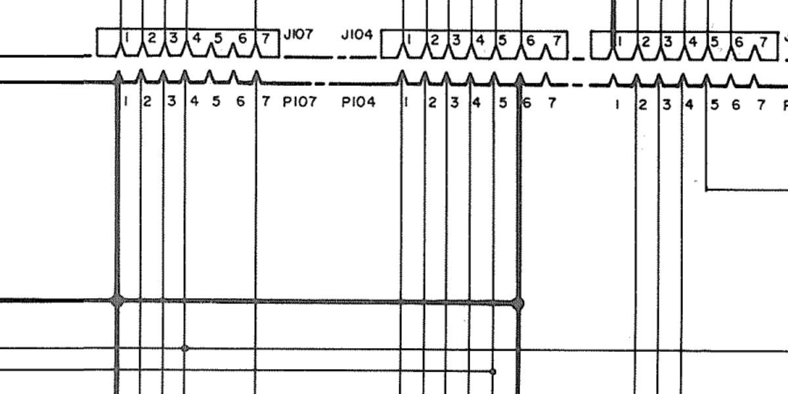
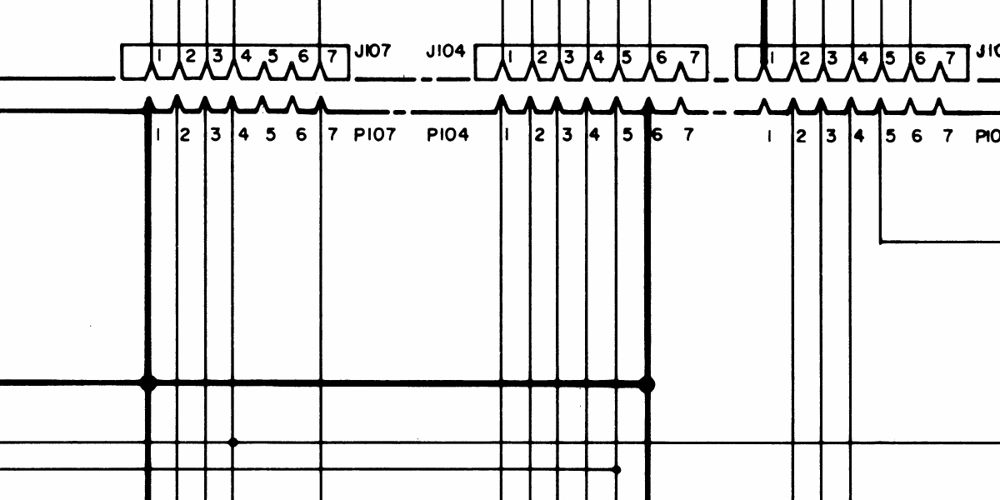
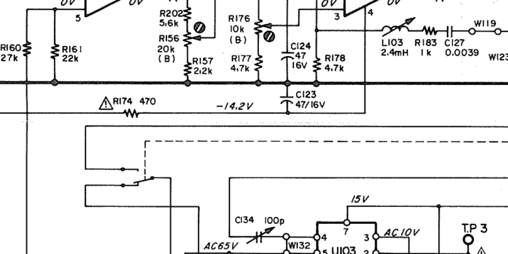
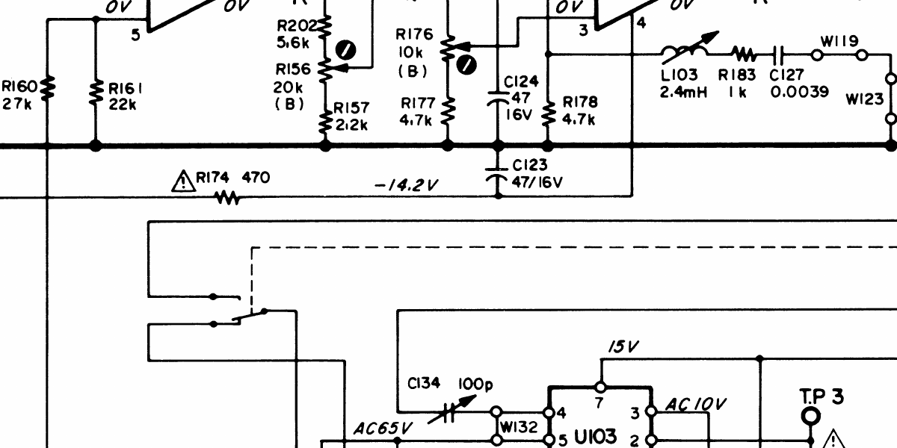

# Tascam 38 Schematics: Color Scans of the Foldout Sheets

The two drawings that matter most for servicing a Tascam 38 aren't pages in the service manual. They're the foldouts — the amplifier and the tape transport, each on one large sheet folded into the back of the book.

I had the foldouts from my own paper manual scanned. Both sheets are posted here for anyone who needs them. No account, no watermark, no viewer — just the PDFs.

---

## The downloads

Tascam 38 · ½-inch · 8-track · 15 ips

| Sheet | Title block | File |
| --- | --- | --- |
| [Amplifier schematic](/downloads/tascam-38/tascam-38-amplifier-schematic.pdf) | 38 AMPLIFIER SCHEMATIC DIAGRAM | 19.4 MB PDF |
| [Tape transport schematic](/downloads/tascam-38/tascam-38-transport-schematic.pdf) | 38 TAPE TRANSPORT SCHEMATIC DIAGRAM | 24.3 MB PDF |

Each PDF is a single page holding one JPEG of the full sheet: 9000 × 5250 px · 300 ppi · 24-bit color, landscape, about 30 × 17.5 inches at print size.

SHA-256, to confirm you have the same bytes:

```
4cd4961067d844c9df0c0958683038004e2d3d34c101e5f79d144e511309fd71  tascam-38-amplifier-schematic.pdf
2133794b11d7df0286c08a3ab22102420d08eab4e6a163aac2a0b0c21db649cd  tascam-38-transport-schematic.pdf
```

The amplifier sheet covers the channel-1 REC/PLAY AMPL card in full, the MOTHER PCB with every card connector J101–J108 and its P-side mate, the HEAD PCB, IN/OUT, FUNCTION, OUT SELECT and MASTER OSC boards, and the P171 supply and control bus. The transport sheet covers the power supply, motor and transport control, keyboard, sensors and counter.

The drawings are TEAC's. These are scans of my copy, posted for repair and reference.

→ [Amplifier schematic (PDF)](/downloads/tascam-38/tascam-38-amplifier-schematic.pdf)

→ [Tape transport schematic (PDF)](/downloads/tascam-38/tascam-38-transport-schematic.pdf)

---

## How these compare to the peel.dk scan

There's already a good scan of these sheets in circulation: `Tascam 38 Complete schematics (High quality scan).pdf`, in the [peel.dk Tascam archive](https://peel.dk/Archive/Tascam/). It's 2.2 MB, which looks small. It isn't.

| | peel.dk | This scan |
| --- | --- | --- |
| Amplifier sheet | 34134 × 19392 px | 9000 × 5250 px |
| Resolution | 1200 ppi | 300 ppi |
| Color | 1-bit black/white | 24-bit color |
| Compression | CCITT (fax) | JPEG |
| File size | 2.2 MB, both sheets | 43.7 MB, both sheets |

The peel.dk file is a 1200 ppi bilevel scan. Fax compression packs a black-and-white line drawing into almost nothing, so the size says nothing about the resolution. These scans aren't a replacement for it. They're a second, independent digitization of a different paper copy.

Here's the same region of the amplifier sheet in both — the P107 and P104 connectors on the motherboard, rendered at the same scale.





And a dense patch of component labels from the record path — R156, R157, R174, C123/C124, L103.





Every junction dot, pin number and component value reads in both. The bilevel scan has crisper edges. The color scan keeps the paper — tone, faint marks, punch holes along the binding edge — because nothing was thresholded away.

When two independent scans of two physical copies agree, you can trust the drawing more than you could trust either one alone. That's the point of posting a second one.

---

## Why I needed them

The Tascam 38 has eight amplifier cards — one per channel, all interchangeable — plugged into a motherboard through eight connectors per card. The cards and their card-edge contacts are the failure-prone part of the machine. The plan is a pin-compatible replacement card that keeps the original motherboard, transport, heads and bias oscillator. Get one channel working on the bench before touching anything else.

That plan needs every contact accounted for. J101–J108 carry 50 contacts per card. I traced them by hand first, from the drawing into a spreadsheet: source pin, destination, voltage, components, function. Where I couldn't tell, I wrote `X`.

A hand trace is a hypothesis until it's checked against the drawing, and checking it means following individual conductors across the MOTHER PCB — long parallel runs, crossings, and the junction dots that decide whether two lines connect or just pass. The crops above are a case in point: the heavy conductor ties **P107-1** to **P104-6**. My worksheet marks J107-1 and J104-6 both as ground. Agreement.

**A note on file size.** I had an AI agent working through the contact-by-contact verification. Early on it concluded the peel.dk scan was too coarse to certify motherboard junctions, and recorded that as the blocker: *"insufficiently distinguishable raster junction/crossing evidence on the current scan."* Its notes filed the 2.2 MB file as the "lower-resolution" copy. At native resolution the junctions are perfectly clear. The limit was how the file was being viewed, not the scan. File size isn't resolution.

---

## What's next

The trace work, the spreadsheet audit and the verification notes live in the [audio-circuits repository](https://github.com/oletizi/audio-circuits/tree/main/docs/tascam-38). The 50-contact netlist is not verified end to end, and no replacement card has been built or powered. Until it is, treat every pin assignment as a candidate.

If you're working on a 38 and find a disagreement between these scans, the peel.dk scan, and your machine, I'd like to hear about it. The machine wins.
